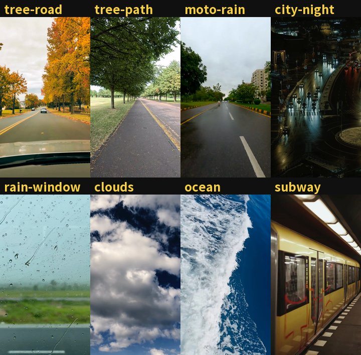

# Zihan-video-skill · 镜头旋转大字报

Claude Code / Codex Agent Skill：把口播稿做成 9:16 竖屏「字幕翻转」短视频——大字逐字跟口播出现，每句镜头转 90°，全片跟配乐卡点。

<p align="center"></p>

## 怎么触发

装好后在 agent 里直接说：

> 做一个字幕翻转视频 / 文字翻转视频 / 旋转字幕视频 / 散落字幕 / 大字报口播 / 用 zihan 的 skill

或者发一张这类视频的截图说「复刻这个」。

## 入场效果

同一段稿，只换 `reveal`：瀑布 `waterfall` / 反转 `flip` / 滑入 `slide` / 无 `none` / 翻滚 `tumble` / 弹跳 `pop` / 遮罩上滑 `rise` / 故障 `glitch`，默认 `mix` 混用。

<p align="center"></p>
<p align="center"></p>

## 版式

`"layout": "chain"`（默认）镜头旋转；`"layout": "scatter"` 散落：不转镜头，字块随机位置、随机大小跟着口播弹出。

<p align="center"></p>

## 背景

`"background"`：`grid` 平面网格（默认）/ `room` 3D 网格房间 / 任意视频或图片（项目里放 `bg.mp4` 即可）。

<p align="center"></p>

自带 8 条模板背景，`python scripts/get_backgrounds.py` 下载后写名字就能用，如 `"background": "tree-road"`：

<p align="center"></p>

## 字体

`"font"`：下面这些预设，或任意字体文件（`得意黑` 需自备文件）。

<p align="center"></p>

## 安装

```bash
git clone https://github.com/tbszz/Zihan-video-skill ~/.claude/skills/Zihan-video-skill
pip install faster-whisper librosa edge-tts Pillow
```

另需 ffmpeg 和 Node 22。

## 手动运行

```bash
python scripts/pipeline.py video-projects/my-video
```

项目目录放 `script.txt`（稿件）和 `bgm.mp3`（配乐），可选 `config.json`、`card.png`、`bg.mp4`。稿件写法见 [script-format.md](references/script-format.md)，参数见 [style-spec.md](references/style-spec.md)。

## 许可

代码 MIT；字体 Noto Sans SC / Noto Serif SC / 马善政毛笔楷书，SIL OFL 1.1；模板背景来自 [Pexels](https://www.pexels.com/license/)，不随仓库分发。
