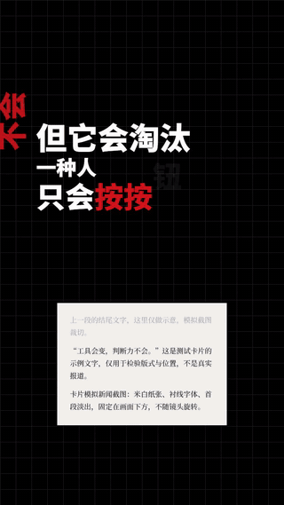
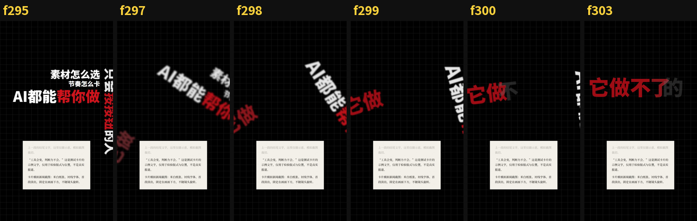
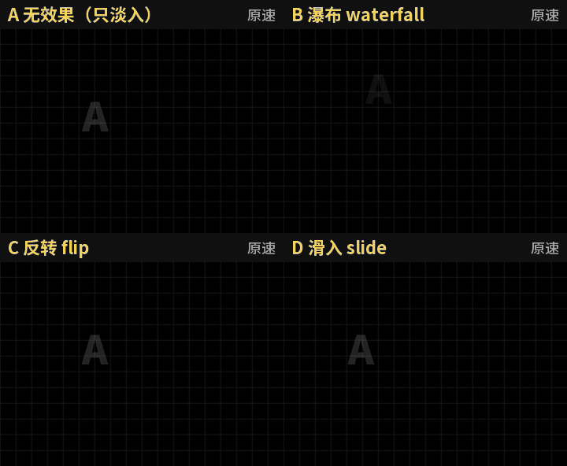
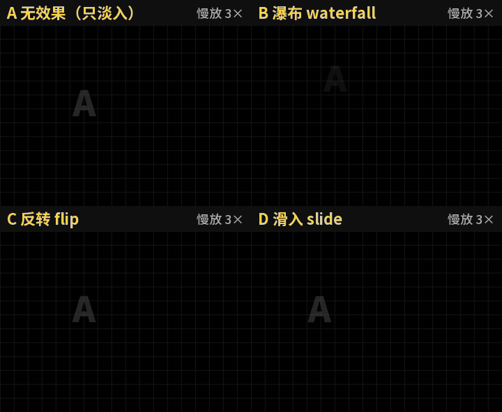
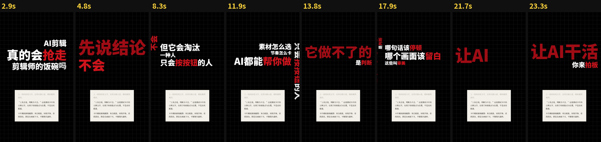
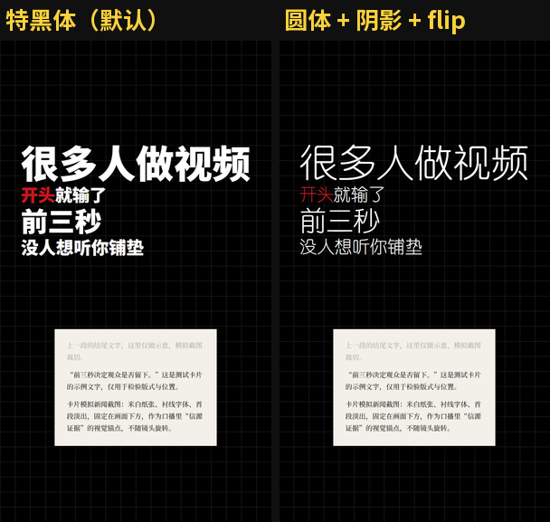

# Zihan-video-skill · 镜头旋转大字报

一个 Claude Code / Codex Agent Skill：把一段口播稿做成 9:16 竖屏「镜头旋转大字报」短视频。黑底网格上逐字跟着口播蹦出粗黑大字，每换一句镜头整页转 90°，新句挨着上一句的首字接上，说过的话竖着滑出屏幕；全片跟配乐卡点，下方固定一张新闻截图卡做信源。

写稿 → 配音 → 字级对齐 → 测拍 → 排版和镜头 → 自动检查 → Remotion 渲染，一条命令跑完。

<p align="center"></p>

> 演示素材全部来自本仓库自带的测试稿（原创观点），截图卡是示意文字，不是真实报道。GIF 无声。

## 效果

### 每句转 90°，整页绕一个点转

不是位置、角度、缩放各插各的值（那样旧句会像被「扔出去」），而是螺旋相似变换：整页绕一个固定轴心刚性旋转并同步缩放，新句在转的同时被带进画面。转完后上一句竖立在旁边、大部分出屏，新句第一行和上一句首字同高紧挨。



### 逐字入场效果

`config.json` 的 `reveal` 选一种，或 `mix`（默认，每行随机抽一种）。每个字 4 帧完成，不拖慢转向。

下面是 A/B 对比：同一段稿、同一个 `seed`，排版和镜头完全一样，只改 `reveal` 这一个变量。

- A `none`：只有灰→白淡入（对照组）
- B `waterfall` 瀑布：字从上方划落
- C `flip` 反转：字从镜像翻 180° 转正
- D `slide` 滑入：字从左侧滑入

<p align="center"></p>

效果很快，原速下主要是节奏感；慢放 3× 能看清每种动法：

<p align="center"></p>

### 字号有大有小、重点句砸入、红色关键词



### 可选字体

`特黑体`（默认，Noto Sans SC 900）/ `粗黑体` / `细体` / `圆体` / `黑体` / `等线` / `得意黑`，或者直接给一个字体文件。排版按所选字体实测宽度，换字体不会出框。



## 安装

把仓库放进 agent 的 skills 目录，例如：

```bash
git clone https://github.com/tbszz/Zihan-video-skill ~/.claude/skills/Zihan-video-skill
```

依赖：

- Python 3.10+：`pip install faster-whisper librosa edge-tts Pillow`
- ffmpeg / ffprobe 在 PATH 里
- Node 22（渲染引擎 `engine/` 是 Remotion 4，首次渲染自动 `npm install`）
- edge-tts 配音需要联网

自带 Noto Sans SC / Noto Serif SC 可变字体，所以默认字体在任何系统上都能用；`圆体`、`黑体`、`等线` 这几个预设用的是 Windows 系统字体。

## 使用

在 agent 里说「做一条 Zihan 视频」「旋转字幕视频」「大字报口播」即可，skill 会问齐选题、配乐、截图卡，写好稿子先给你确认再生成。

也可以手动跑。一个视频一个项目目录：

```
video-projects/my-video/
  script.txt     稿件（唯一文字来源）
  bgm.mp3        配乐（用来卡点，必需）
  config.json    可选参数
  card.png|txt   截图卡（可选；只给 txt 会自动生成纸质卡）
  voice.mp3      自己的录音（可选；没有就用 edge-tts）
```

```bash
python scripts/pipeline.py video-projects/my-video
```

成片在 `out/my-video.mp4`，另有抽帧总览 `_sheet.png` 和每次转向的逐帧条 `out/turns/`。

### 稿件格式

```
# 行首 # 是注释
很多人做视频/[开头]就输了/前三秒/没人想听你铺垫
!观众只给你[三秒]
所以第一句话/直接给[结论]/再给[证据]

为什么要放[截图]/因为它是/[证据]不是观点
```

一行 = 一句（镜头转一次），`/` 组内换行，`[词]` 红字，行首 `!` 重点句（放大、深红、砸入），空行换段（转得更慢更柔）。详见 [references/script-format.md](references/script-format.md)。

### config.json

```json
{
  "seed": 7,
  "cover": "前三秒\n决定生死",
  "bgm_offset": 8,
  "font": "特黑体",
  "reveal": "mix",
  "text_shadow": 0,
  "text_stroke": 0,
  "music_only": false
}
```

全部可调项见 [references/style-spec.md](references/style-spec.md)。不满意布局就换 `seed`。

## 自动检查

`check_turns.py` 用和渲染引擎同一套镜头数学逐个验证每次转向，不通过就不渲染：

- 正好 ±90°、角度单调不回摆
- 转完上一句竖立、新句水平
- 轴心在画面内，上一句大部分出屏
- 新句和上一句首字同高且紧挨
- 转向时新句已经在画面里
- 转向踩在拍点上（快歌允许踩半拍）

```
turn  4 f= 296 d= 7 踩拍 入字f=296 字顺时针 -90°  pivot=(386,776)  上一句可见   0%  接口: 高差 0.00 字 / 间距 0.2 字  OK  「它做不了的」
7 turns, 0 problems, 0 warnings
```

## 目录

```
SKILL.md              agent 读的流程说明
references/           稿件格式、画面规格和可调参数
scripts/              pipeline / tts / align / beats / build_timeline / check_turns / render / make_card
engine/               Remotion 渲染引擎（React，只负责画；排版和镜头都在 Python 里算好）
assets/fonts/         Noto Sans SC、Noto Serif SC（SIL OFL 1.1）
docs/                 README 用的截图
```

## 许可

代码：MIT，见 [LICENSE](LICENSE)。字体：Noto Sans SC / Noto Serif SC，SIL Open Font License 1.1，见 [assets/fonts/OFL.txt](assets/fonts/OFL.txt)。

配乐、配音和截图卡请使用你有权使用的素材；用外部报道做截图卡时自行核实并注明来源。
