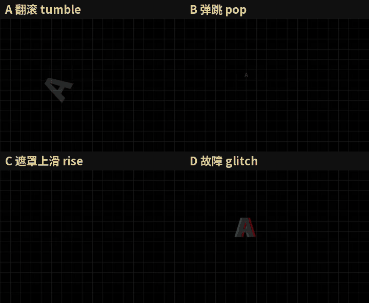
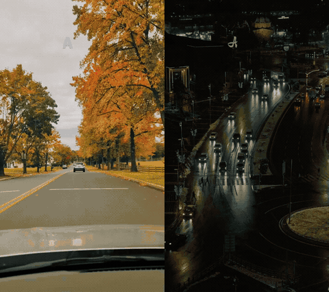
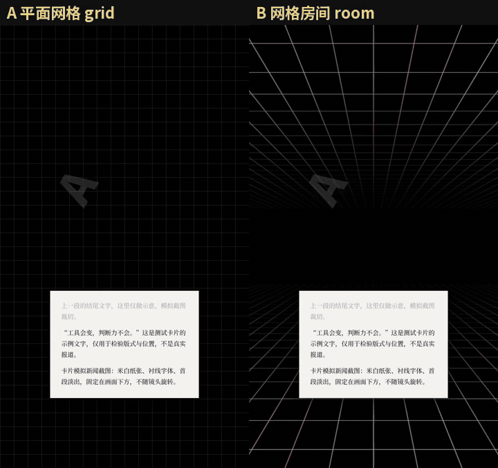

# Zihan-video-skill · 镜头旋转大字报

Claude Code / Codex Agent Skill：把口播稿做成 9:16 竖屏「镜头旋转大字报」短视频——大字逐字跟口播出现，每句镜头转 90°，全片跟配乐卡点。

<p align="center"></p>

## 入场效果

同一段稿，只换 `reveal`：

<p align="center"></p>
<p align="center"></p>

## 散落版式 + 视频背景

`"layout": "scatter"`：不转镜头，字块随机位置、随机大小跟着口播弹出。背景可换成任意视频/图片（项目里放 `bg.mp4`），自带 8 条模板背景（`python scripts/get_backgrounds.py` 下载）。

<p align="center"></p>

## 网格房间背景

`"background": "room"`：

<p align="center"></p>

## 字体

`特黑体`（默认）/ `粗黑体` / `细体` / `圆体` / `黑体` / `等线` / `得意黑` / `泼墨`，或任意字体文件。


## 安装

```bash
git clone https://github.com/tbszz/Zihan-video-skill ~/.claude/skills/Zihan-video-skill
pip install faster-whisper librosa edge-tts Pillow
```

另需 ffmpeg 和 Node 22。

## 使用

在 agent 里说「做一条 Zihan 视频」，或手动运行：

```bash
python scripts/pipeline.py video-projects/my-video
```

项目目录放 `script.txt`（稿件）和 `bgm.mp3`（配乐），可选 `config.json`、`card.png`、`bg.mp4`。稿件写法见 [script-format.md](references/script-format.md)，参数见 [style-spec.md](references/style-spec.md)。

## 许可

代码 MIT；字体 Noto Sans SC / Noto Serif SC / 马善政毛笔楷书，SIL OFL 1.1；模板背景来自 [Pexels](https://www.pexels.com/license/)，不随仓库分发。
